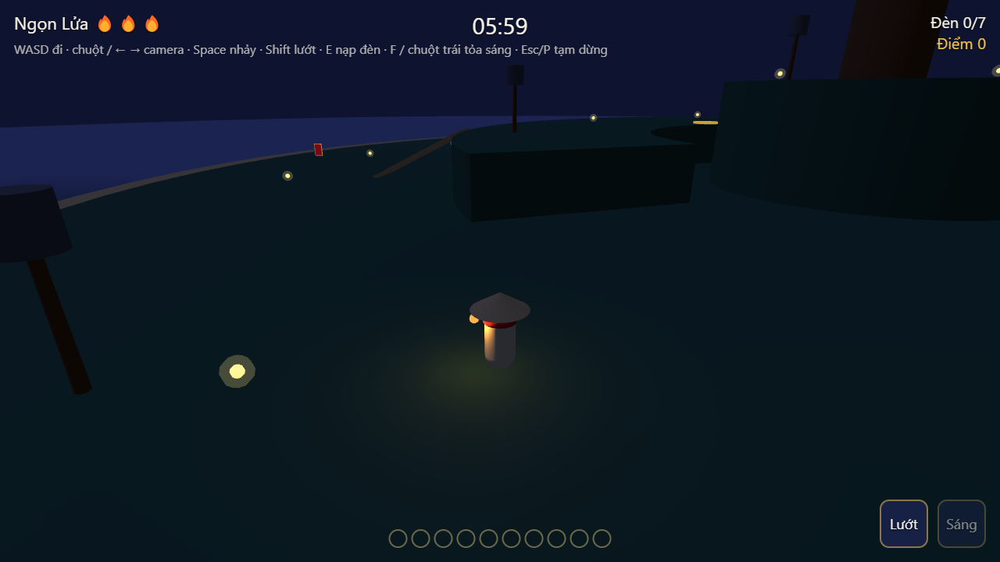

# Đảo Đèn Lồng

> 🎬 **Video demo:** [Xem video (Google Drive)](https://drive.google.com/file/d/1_eZll-8A5xa0kczBCMeC2GR2es96JJq0/view?usp=sharing) · 📦 **Release:** [v1.0.0](../../releases/tag/v1.0.0)

Game 3D góc nhìn thứ ba. Mây, người giữ đèn nhỏ tuổi đội nón lá treo đèn lồng, gom đom đóm để thắp và **giữ** các Đèn Lồng Lớn sáng tới bình minh trên 3 hòn đảo (Đảo Bến, Đảo Cau, Đảo Chuông), né Bóng Mực hút dầu và Gió Lạc cướp ánh sáng. Bài lab Day 12 AI SDLC (đề gốc: [docs/lab/](docs/lab/README.md)).



## Yêu cầu hệ thống
- macOS, Linux hoặc Windows; **Node.js ≥ 20** (kèm npm). Đã kiểm trên Node 24 / Windows 11.
- GPU hỗ trợ WebGL2. Cửa sổ 1280×720.
- Khoảng 300 MB đĩa cho `node_modules` (Electron tải binary ở lần cài đầu).

## Cài đặt và chạy (3 lệnh)

```bash
git clone <repo> && cd <repo>
npm ci
npm start
```

`npm start` build bản web rồi mở cửa sổ Electron. Nếu npm bỏ qua script cài đặt của Electron, launcher tự tải lại binary.

## Điều khiển (đổi được trong Cài đặt → Phím)

| Phím mặc định | Hành động |
|---|---|
| W A S D | Di chuyển (theo hướng camera) |
| Chuột (bấm vào cửa sổ để khóa chuột) / ← → | Xoay camera |
| Space | Nhảy |
| Shift trái | Lướt (14 m/s trong 0.2 s, hồi chiêu 1.5 s) |
| E | Nạp đom đóm vào đèn / châm dầu / thắp lại |
| F / chuột trái | Tỏa Sáng (tốn 3 đom đóm, bán kính 5 m, hồi chiêu 3 s) |
| Esc | Tạm dừng: Tiếp tục / Chơi lại Đêm / Cài đặt / Về menu |

**Cài đặt** (được lưu): âm lượng, độ nhạy chuột, bảng màu dễ phân biệt, giảm chuyển động, chữ lớn ×1.25, đổi phím (báo trùng phím, khôi phục mặc định).

## Luật và cách tính điểm
- Chuỗi 3 Đêm: Đảo Bến (5 đèn, 4 phút) → Đảo Cau (6 đèn, 4:30, hai đảo nối cầu tre, bục nhảy) → Đảo Chuông (7 đèn, 5 phút, 3 tầng, gió mạnh). Thắng Đêm 3 → màn **Bình Minh**; thua → chơi lại Đêm đó.
- Đi gần đom đóm (≤ 1 m) để nhặt. Sức chứa 10, +2 mỗi lần thắp thành công (tối đa 20). Đèn cần 10 đom đóm để thắp.
- **Đèn cạn dầu:** đèn sáng có 100 dầu, hao 1/giây; bấm E ở đèn đang sáng để châm (mỗi đom đóm +10). Hết dầu thì tắt; thắp lại chỉ cần 5. Đèn < 30 dầu nhấp nháy, mất vùng an toàn 6 m, Bóng Mực sẽ tới hút dầu (5/giây mỗi con).
- Bóng Mực chạm: −1 Ngọn Lửa, rơi một nửa đom đóm, bất tử 1.5 s. Rơi khỏi đảo: −1 Ngọn Lửa, mất hết đom đóm. Gió Lạc cướp 3 đom đóm khi bạn mang ≥ 5. Bùa Gió: 10 s chạy nhanh, lướt không hồi chiêu.
- **Thắng khi trời sáng** mà còn sống và số đèn đang sáng ≥ 60% (3/5, 4/6, 5/7). Thua khi hết 3 Ngọn Lửa hoặc trời sáng mà thiếu đèn.

| Sự kiện | Điểm |
|---|---|
| Mỗi đom đóm nạp vào đèn (thắp, thắp lại, châm dầu) | +5 |
| Thắp lần đầu / thắp lại | +100 / +40 |
| Mỗi Bóng Mực trúng Tỏa Sáng | +5 (+15 nếu nó đang hút dầu) |
| Bình minh (khi thắng): mỗi đèn đang sáng | +50 + số dầu còn lại (làm tròn xuống) |
| Bình minh (khi thắng): mỗi Ngọn Lửa còn lại | +50 |
| Tổng điểm game | Tổng điểm các Đêm đã thắng |

**Bảng xếp hạng:** sau Bình Minh hoặc khi thua, nhập tên (3–12 ký tự: chữ — có thể có dấu —, số, `_`) để lưu; top 10 lưu trên đĩa (`userData/leaderboard.json`), xem từ menu chính.

Số liệu: [src/sim/tuning.js](src/sim/tuning.js), bản đồ: [src/sim/maps.js](src/sim/maps.js), khai báo: [game.contract.json](game.contract.json) (contract **v1.3**).

## Test, CI, headless, bench, soak

```bash
npm test           # 70 test: contract + scenario headless cho từng yêu cầu Phase 1–4
npm run verify     # CI trên máy: test + tất định cả đêm + soak 3 đêm + build (chạy tự động khi git push)

# Headless (Test Contract): 60 tick/s, không cần cửa sổ/GPU
node headless/run.js --seed 1 --night 2 --ticks 600 --out out.jsonl [--inputs f.json] [--scenario f.json] [--snapshot-every 10]

# Benchmark (mở cửa sổ 1280×720, tắt vsync, đo 30 s sau 3 s khởi động)
node scripts/launch.cjs --bench --seed 42 --duration 30 --out bench.json     # hoặc: npm run bench

# Soak: 10 Đêm liên tiếp trong một tiến trình
node --expose-gc headless/soak.js --seed 7 --nights 10 --out soak.json      # hoặc: npm run soak

# Xuất bảng xếp hạng
node scripts/launch.cjs --export-leaderboard out.json
```

Kết quả trên máy tác giả (Ryzen 5 5600H, RTX 3050 Laptop, Windows 11): bench **714 FPS** trung bình, p1 309 FPS, tải 0.58 s ([bench.json](bench.json)); soak 10 Đêm, 0 crash, RAM ×1.165 ([soak.json](soak.json)).
Bật pre-push hook một lần sau khi clone: `git config core.hooksPath .githooks`.

## Sáng tạo của tôi
- **Đảo sáng dần:** đèn đang nạp dở hắt sáng yếu; nón lá của Mây có đèn lồng nhỏ là nguồn sáng thật, bùng sáng khi Tỏa Sáng.
- **Bóng Mực có mắt nhìn theo Mây**, viền đậm khi đuổi/hút dầu, xám tím khi choáng, lớn dần khi đang xuất hiện.
- **Lời Ông Đăng** giới thiệu từng Đêm, **màn Bình Minh** chuyển màu trời, **nhạc nền ngũ cung** và hiệu ứng âm thanh tự tổng hợp (không dùng file ngoài).

Tất cả chỉ ở phần hiển thị (`src/render/`), không đổi output headless (70 test headless + kiểm tra tất định vẫn đạt); trong cảnh bench vẫn ở mức "như lúc chơi thật" và không thêm thực thể.

## Tài liệu
- Bằng chứng: [Phase 1](docs/proof/phase-1.md) · [Phase 2](docs/proof/phase-2.md) · [Phase 3](docs/proof/phase-3.md) · [Phase 4](docs/proof/phase-4.md)
- [CHANGELOG.md](CHANGELOG.md) · [ADR-0001](docs/adr/0001-lantern-fuel-and-dawn-win.md) · [CREDITS.md](CREDITS.md) · [LICENSE](LICENSE)
- Spec Phase 2: [phase-2-spec.md](docs/notes/phase-2-spec.md) · Giả định: [assumptions.md](docs/notes/assumptions.md) · Kế hoạch: [plan.md](docs/notes/plan.md)
- Nhật ký AI và token: [ai-log.md](docs/notes/ai-log.md) · Đánh giá từng phase: [evaluation.md](docs/notes/evaluation.md) · **Retro:** [retro.md](docs/notes/retro.md)
- Harness AI: [AGENTS.md](AGENTS.md), skill [verify-proof](.claude/skills/verify-proof/SKILL.md), hook test [.claude/settings.json](.claude/settings.json), CI trên máy [scripts/verify.mjs](scripts/verify.mjs) + [.githooks/pre-push](.githooks/pre-push)
