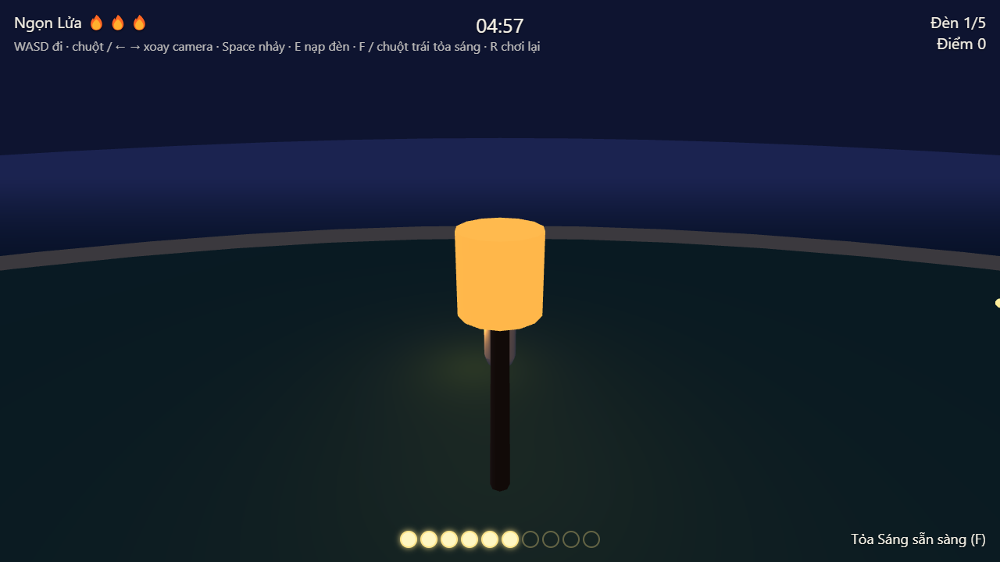

# Đảo Đèn Lồng

> 🎬 Video demo: _(thêm ở Phase 4)_

Game 3D góc nhìn thứ ba: Mây, người giữ đèn nhỏ tuổi, gom đom đóm để thắp lại 5 Đèn Lồng Lớn của Đảo Bến và né Bóng Mực trong sương đen. Bài lab Day 12 AI SDLC (đề gốc: [docs/lab/](docs/lab/README.md)).



## Cài đặt và chạy (macOS / Linux / Windows, cần Node ≥ 20)

```bash
npm ci
npm start
```

`npm start` build bản web rồi mở cửa sổ Electron 1280×720.

## Điều khiển

| Phím | Hành động |
|---|---|
| W A S D | Di chuyển (theo hướng camera) |
| Chuột (bấm vào cửa sổ để khóa chuột) / ← → | Xoay camera |
| Space | Nhảy |
| E | Nạp ánh sáng vào đèn gần nhất (trong 2 m) |
| F / chuột trái | Tỏa Sáng (tốn 3 đom đóm, hồi chiêu 3 s) |
| R | Chơi lại sau khi thắng/thua |

## Luật và cách tính điểm

- Đi gần đom đóm (≤ 1 m) để tự nhặt, mang tối đa 10. Đứng gần đèn bấm E để nạp; đèn cần 10 đom đóm để sáng (nạp nhiều lần được).
- Đèn đã sáng tạo vùng an toàn 6 m mà Bóng Mực không vào được. Bóng Mực chạm vào: mất 1 Ngọn Lửa, rơi một nửa số đom đóm đang mang, bất tử 1.5 s. Rơi khỏi đảo cũng mất 1 Ngọn Lửa.
- Thắng khi thắp đủ 5 đèn. Thua khi hết 3 Ngọn Lửa hoặc hết 5 phút (bình minh).

| Sự kiện | Điểm |
|---|---|
| Mỗi đom đóm nạp vào đèn | +10 |
| Mỗi đèn thắp sáng | +100 |
| Mỗi Bóng Mực trúng Tỏa Sáng | +5 |
| Khi thắng: mỗi giây còn lại (làm tròn xuống) | +2 |
| Khi thắng: mỗi Ngọn Lửa còn lại | +50 |

Mọi số liệu ở [src/sim/tuning.js](src/sim/tuning.js), khai báo trong [game.contract.json](game.contract.json). Không có khóa nào khai `null`.

## Test, CI và headless

```bash
npm test          # 28 test: contract + scenario headless cho từng yêu cầu
npm run verify    # CI trên máy: test + tất định cả đêm + build (cũng chạy tự động khi git push)
node headless/run.js --seed 1 --night 1 --ticks 600 --out out.jsonl [--inputs f.json] [--scenario f.json] [--snapshot-every 10]
```

Bật pre-push hook một lần sau khi clone: `git config core.hooksPath .githooks`.
Ví dụ scenario: [tests/scenarios/](tests/scenarios/). Headless chạy logic 60 tick/s, không cần cửa sổ/GPU (1 đêm 18000 tick ≈ 0.35 s).

## Sáng tạo của tôi

- **Đảo sáng dần:** ánh sáng môi trường tăng theo số đèn đã thắp (0.15 → 0.70), đèn đang nạp dở hắt sáng yếu theo tiến độ.
- **Nón lá có đèn lồng nhỏ** của Mây là nguồn sáng thật, bùng sáng khi Tỏa Sáng.
- **Bóng Mực có viền tím** đậm hơn khi đang đuổi, xám tím khi bị choáng, nhỏ lại khi mới xuất hiện.

Tất cả chỉ nằm ở phần hiển thị (`src/render/`), không đổi output headless: bằng chứng là bộ test headless và kiểm tra tất định vẫn đạt ([docs/proof/phase-1.md](docs/proof/phase-1.md)).

## Tài liệu

- Bằng chứng: [docs/proof/phase-1.md](docs/proof/phase-1.md)
- Kế hoạch: [docs/notes/plan.md](docs/notes/plan.md) · Giả định: [docs/notes/assumptions.md](docs/notes/assumptions.md)
- Nhật ký AI và token: [docs/notes/ai-log.md](docs/notes/ai-log.md) · Đánh giá phase: [docs/notes/evaluation.md](docs/notes/evaluation.md)
- Harness AI: [AGENTS.md](AGENTS.md), hook test [.claude/settings.json](.claude/settings.json), CI trên máy [scripts/verify.mjs](scripts/verify.mjs) + [.githooks/pre-push](.githooks/pre-push), workflow [.github/workflows/ci.yml](.github/workflows/ci.yml)
